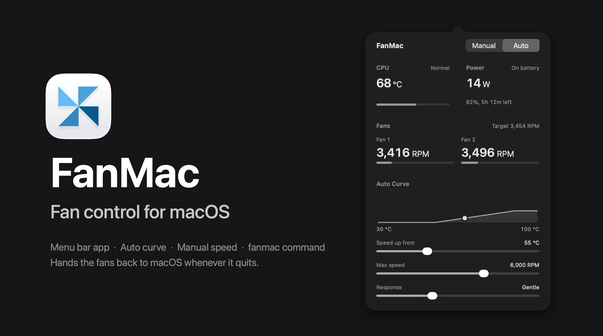

# FanMac: free fan control app for Mac

**Control your Mac's fan speed from the menu bar.** FanMac is a free, open-source fan control app for macOS. Set the fans of a MacBook Pro, iMac, Mac mini or Mac Studio to a fixed speed, or let them follow CPU and GPU temperature on a curve you shape. It shows live temperatures, fan RPM and, on laptops, power draw in the menu bar, and comes with a `fanmac` command for the terminal. It's a native SwiftUI app, built as one universal app for Apple Silicon (M1 and later) and Intel Macs.

[](https://github.com/ardhitama/homebrew-tap/releases/latest)
[](LICENSE)


<!-- banner -->


FanMac is an open-source alternative to Macs Fan Control and TG Pro. Its SMC code comes from [smcFanControl](https://github.com/hholtmann/smcFanControl).

## Features

- **Manual fan speed**: hold every fan, or each fan on its own, at the RPM you choose. Run a MacBook Pro cooler under load, or quieter when it isn't.
- **Automatic fan curve**: the fans stay at their minimum until the temperature you pick, then speed up with the hotter of the CPU and GPU, up to the max speed you set. Small temperature changes don't make them hunt up and down.
- **CPU and GPU temperature monitor**: live temperatures, fan speeds and thermal pressure, plus power draw and battery health on laptops, in a menu bar popover whose widgets you arrange (right-click the menu bar icon and choose **Edit Widgets**). The menu bar can show the temperature, power or fan speed next to the icon.
- **Alerts**: a notification when the CPU runs hot, and an option to switch to Auto when it does.
- **Command line**: `fanmac status`, `fanmac manual 4000`, `fanmac auto --max 5000` and a live `fanmac watch` view, for scripts and the terminal.
- **Hands the fans back to macOS**: when the Mac sleeps, when FanMac quits, when Auto can't read a temperature, and through a watchdog process if FanMac crashes. Fans never go below the minimum or above the maximum speed the Mac reports.
- **Opens at login**, if you want it to, and can hide its menu bar icon.
- **Lightweight**: under 1% of one CPU core, and no fan write unless the speed actually changes.
- **Private**: no account, no ads, no tracking. FanMac makes no network connections.
- **Open source**: GPL-3.0-or-later, so it stays free.

## Install

With [Homebrew](https://brew.sh):

```bash
brew trust --tap ardhitama/tap
brew tap ardhitama/tap
brew install --cask fanmac
```

This installs FanMac.app and puts the `fanmac` command on your `PATH`. Homebrew asks you to trust the tap first because it isn't one of Homebrew's own. `brew upgrade --cask fanmac` updates both.

If a downloaded FanMac.app is already in Applications, Homebrew stops rather than replace it. Run `brew install --cask --force fanmac` to replace it; your settings and the helper stay.

Or download `fanmac-macos.tar.gz` from the [latest FanMac release](https://github.com/ardhitama/homebrew-tap/releases/latest) and move **FanMac.app** to `/Applications/`.

Then open FanMac, click "Install Helper" and enter your password once.

## Control Modes

### Manual Mode
- Set a fixed fan speed using the slider
- Speed is maintained regardless of temperature

### Automatic Mode
- FanMac starts in Auto
- FanMac sets the speed from the hotter of the CPU and GPU
- Up to **Speed up from** (40–90 °C): fans stay at their minimum speed
- Above it: speed rises linearly and, at the default **Response**, reaches **Max speed** at 90 °C
- **Response** blends the curve toward minimum (quieter: the fans stay under Max speed) or toward Max speed (cooler: they run faster even when cool)
- Fans speed up as soon as the curve rises 100 RPM, and slow down once it has stayed 150 RPM lower, or at the minimum, for 10 seconds, so they don't chase every degree
- If no CPU or GPU temperature reads for 6 seconds, the fans go back to macOS until one does

## Terminal

FanMac.app includes a `fanmac` command. Homebrew puts it on your `PATH`. Otherwise, open **Settings → Command Line** and click **Install…**. After an administrator prompt, it links `/usr/local/bin/fanmac` to the copy inside the app, so updating the app updates the command. To link it yourself:

```bash
sudo mkdir -p /usr/local/bin
sudo ln -sf /Applications/FanMac.app/Contents/Helpers/fanmac /usr/local/bin/fanmac
```

| Command | What it does |
|---|---|
| `fanmac watch` | Live view, and the default when you run `fanmac` in a terminal. `m` Manual, `a` Auto, `↑↓` choose a setting, `←→` change it, `q` quit |
| `fanmac status [--json]` | Temperatures, fan speeds, and who controls the fans |
| `fanmac manual [RPM] [--fan N]` | Switch to Manual; hold every fan, or only fan N (from 1), at RPM |
| `fanmac auto [--from °C] [--max RPM] [--response 0–3]` | Switch to Auto and change its curve |
| `fanmac version` | The version, copyright and license |

The command asks the running app to make each change over a socket that only your user can open (`~/Library/Application Support/FanMac/control.sock`), so the app remains the one process that drives the fans. `watch`, `manual` and `auto` start FanMac if it isn't running; `status` doesn't. Exit codes: 0 success, 1 failure, 2 usage error.

## FAQ

### How do I control the fan speed on my Mac?

Install FanMac, click **Install Helper** and enter your password once. Then choose **Manual** in the menu bar popover and drag the speed slider, or run `fanmac manual 4000` in the terminal. To set each fan on its own, turn on **Separate speed for each fan**, or run `fanmac manual 4000 --fan 2`.

### How do I make my MacBook Pro fans spin faster when it gets hot?

Choose **Auto**. Set **Speed up from** to the temperature where the fans should start rising, and **Max speed** to how fast they may go. A higher **Response** runs them faster sooner. FanMac follows the hotter of the CPU and GPU. In Settings, **Switch to Auto when hot** moves FanMac from Manual to Auto when the CPU passes your alert temperature.

### Can FanMac make my Mac quieter?

Yes, within limits. In Auto, a lower **Response** keeps the fans slower, and in Manual you choose the speed. FanMac never sets a fan below the minimum speed the Mac reports, and macOS still slows the CPU if it gets too hot.

### Is it safe to control the fans on a Mac?

FanMac keeps every fan between the minimum and maximum speeds the Mac's System Management Controller (SMC) reports. It gives the fans back to macOS when the Mac sleeps and whenever FanMac quits. If FanMac crashes, its watchdog process gives them back within about a second. macOS keeps its own thermal protection throughout.

### Does FanMac work on a MacBook Air?

MacBook Air has no fans, so there is nothing to control. FanMac still shows its temperatures, power draw and battery.

### Which Macs does FanMac support?

Macs with fans on macOS 26.1 or later: MacBook Pro, iMac, Mac mini, Mac Studio and Mac Pro, with Apple Silicon or Intel. Development and testing happen on a 14-inch MacBook Pro with M4 Pro. If something doesn't read right on your Mac, please [open an issue](https://github.com/ardhitama/fanmac/issues) with the output of `fanmac status --json`.

### Why does FanMac need an administrator password?

macOS allows only root to write fan speeds to the SMC. FanMac installs a small helper once, with your password. The app itself runs as you and asks the helper for each change. `brew uninstall --zap --cask fanmac` removes the helper.

### How is FanMac different from Macs Fan Control, TG Pro or smcFanControl?

Macs Fan Control and TG Pro are closed source: TG Pro is paid, and Macs Fan Control sells a Pro version. FanMac is open source under the GPL, with no paid tier and no network connections. smcFanControl is open source too, but hasn't changed since 2023; FanMac reuses its SMC code under the GPL.

## How FanMac handles the fans

### SMC Access

This app accesses the System Management Controller (SMC) to read temperatures and control fans. Due to macOS security restrictions:

1. **Temperature Reading**: Works on most Macs without special privileges
2. **Fan Control**: Requires root/admin privileges on modern macOS versions

### Helper Tool Installation

On first launch, the app will prompt you to install a helper tool. This is a **one-time setup**:

- Click "Install Helper" in the app
- Enter your admin password once
- The helper tool enables fan control without repeated password prompts
- After an app update that ships a changed helper, the app asks you to click "Update Helper" (one password prompt)

Before installing, FanMac checks that the helper is signed by the same developer as the app.

To remove the helper and its `sudoers` rule along with the app, uninstall with `brew uninstall --zap --cask fanmac`. A plain `brew uninstall` and every upgrade leave the helper in place, as does moving FanMac.app to the Trash. To remove them yourself:

```bash
sudo rm -f /Library/PrivilegedHelperTools/fanmac-smc-helper /etc/sudoers.d/smc-fan-helper
```

The helper only sets fan speeds within the limits the Mac reports, or hands fans back to macOS.

### Sleep and other fan apps

When the Mac goes to sleep, FanMac hands the fans to macOS, and takes them back about 2 seconds after it wakes. Brief wakes with the display off, such as Power Nap, leave the fans with macOS. A display sleep or screen lock doesn't hand them back: the Mac is still awake, so Manual holds its speed and Auto keeps following temperature with the screen off. A change made while the Mac goes to sleep, such as a `fanmac` command or Switch to Auto when hot, takes effect when it wakes.

If another fan app or tool hands the fans to macOS, or sets its own speed, while FanMac runs, FanMac takes them back within a few seconds, at most once every 10 seconds. Quit FanMac to let another fan app drive the fans.

### Quitting

However FanMac quits — Quit, logging out, `brew upgrade` or `brew uninstall`, `kill`, or Control-C — it returns the fans to macOS first. If FanMac crashes or is force quit (including `kill -9`), a small watchdog process it starts returns them instead, within about a second. Only ending FanMac and its watchdog together skips both; open FanMac and quit it to hand the fans back.

Opening a second copy of FanMac, such as a downloaded one while Homebrew's copy runs, leaves the running copy in charge of the fans; the second copy quits.

### Macs without fans

On a Mac without fans, such as a MacBook Air, FanMac shows temperatures and power and doesn't ask for the helper; there is nothing to control. `fanmac manual` and `fanmac auto` say so and exit with 1.

## Requirements

- **macOS 26.1 or later**. Homebrew can't tell macOS 26.0 from 26.1, so on 26.0 it installs FanMac, but macOS won't open it until you update.
- **A Mac with Apple Silicon or Intel** (one universal build). Fan control needs a Mac with fans.

## Known Limitations

1. **Tested on one Mac**: FanMac is developed and tested on a MacBook Pro with M4 Pro. Other models may name their sensors differently, so some temperatures may not show
2. **Administrator account**: the helper runs without a password for administrators only. On a standard account, each fan change asks for an administrator's name and password, so fan control is impractical there
3. **Not in the App Store**: SMC access needs an app without the App Sandbox

## Troubleshooting

### No Temperature Data
- Ensure the app has SMC access (not sandboxed)
- Run `fanmac status` to see what FanMac reads

### Fan Control Not Working
- Click **Install Helper**, or **Update Helper**, in the popover and enter your password
- `fanmac status` says whether the helper is ready and who controls the fans

### App Not Appearing in Menu Bar
- Check if the app is running in Activity Monitor
- Look for the fan icon in the menu bar

## For developers

### Architecture

#### Files

- **fan/App/FanMacApp.swift**: App entry point and AppDelegate
- **fan/Core/SystemMonitor.swift**: Reads temperatures, fan speeds and fan limits from the SMC, without privileges
- **fan/Core/FanController.swift**: Manual and Auto control, sleep and quit hand-backs; writes through the helper
- **fan/Core/FanReleaseWatchdog.swift**: The watchdog that returns the fans to macOS if FanMac crashes
- **fan/Core/PermissionsManager.swift**: Installs and updates the helper and its `sudoers` rule
- **fan/Core/ControlServer.swift**: Serves the `fanmac` command over a UNIX socket
- **fan/Core/StatusBarManager.swift**: Menu bar icon and popover
- **fan/FanControlViewModel.swift**: App state for the popover, Settings and the menu bar, and the heat alert
- **fan/UI/**: SwiftUI views, the widget dashboard and the theme
- **Shared/**: The fan curve and the control protocol, shared by the app and the command
- **tools/fanmac-cli/**: The `fanmac` command, embedded at `FanMac.app/Contents/Helpers/fanmac`
- **tools/smc-helper/**: The root helper, built into `FanMac.app/Contents/Resources/smc-helper`

#### SMC Keys Used

**Temperatures:** the CPU and GPU keys FanMac reads are listed in `fan/Core/SystemMonitor.swift` (`cpuTempKeysAS` and `gpuTempKeysAS` for Apple Silicon, with Intel fallbacks). FanMac shows the hottest plausible reading of each set.

**Fans:**
- `FNum` - Number of fans
- `F0Ac`, `F1Ac`, etc. - Actual fan speed
- `F0Mn`, `F0Mx` - Min/Max fan speed
- `F0Tg` - Target fan speed (for manual control)
- `F0Md` (`F0md` on M5) - Fan mode (0 = macOS, 1 = manual)
- `Ftst` - Holds off macOS's thermal daemon while a fan is manual, where the Mac has it

### Build Configuration

The project uses:
- Sandbox: **Disabled** (required for SMC access)
- Hardened Runtime: **Enabled**
- IOKit Framework: Linked
- ServiceManagement Framework: Linked

Releases are built, signed, notarized and published to the Homebrew tap by `scripts/release.sh`; its header lists what it needs.

### Tests

```bash
scripts/test.sh                 # every file in fanTests/
scripts/test.sh FanCurveTests   # one or more test classes
```

The script compiles the app's sources with the tests into one XCTest bundle and runs it, so the tests never launch FanMac or write the fans. The Xcode project has no test target for that reason: a hosted test would start a second FanMac beside the one you use.

After a UI change, `scripts/capture-ui.sh` saves a screenshot of the popover, Settings and the widget gallery in each state (Auto, Manual, per-fan, one fan, four fans, macOS in control, hot, thermal pressure, a failed fan change, helper missing or outdated, a Mac without fans or without a battery, Battery and System widgets, editing) to `build/ui-captures/`, to look over side by side. Each window shows for a few seconds; your terminal needs Screen Recording access.

## License

Copyright © 2026 Ardhitama.

FanMac is free software: you can redistribute it and/or modify it under the terms of the GNU General Public License as published by the Free Software Foundation, either version 3 of the License, or (at your option) any later version. See [LICENSE](LICENSE). FanMac comes with no warranty. Whoever distributes FanMac, changed or not, must offer its full source under the same terms; the source of each release is tagged in this repository.

The SMC helper's `tools/smc-helper/smc.c` and `smc.h` come from [smcFanControl](https://github.com/hholtmann/smcFanControl) and are GPL-2.0-or-later; their headers name their authors.

### Name and icon

The GPL covers FanMac's code, not its name or icon. Under additional terms the GPL allows (sections 7(c) and 7(e)), you may refer to FanMac by name and pass on unmodified official releases, but a modified version must use another name, icon and bundle identifier, and the name and icon may not be used to sell or promote anything without written permission. [NOTICE](NOTICE) has the full terms; the app shows them in **Settings → About**.

### Text and data mining

Ardhitama reserves the rights of text and data mining in FanMac's code and documentation, including their use to train or fine-tune AI models, as Article 4(3) of Directive (EU) 2019/790 allows. This reservation is separate from the GPL.
